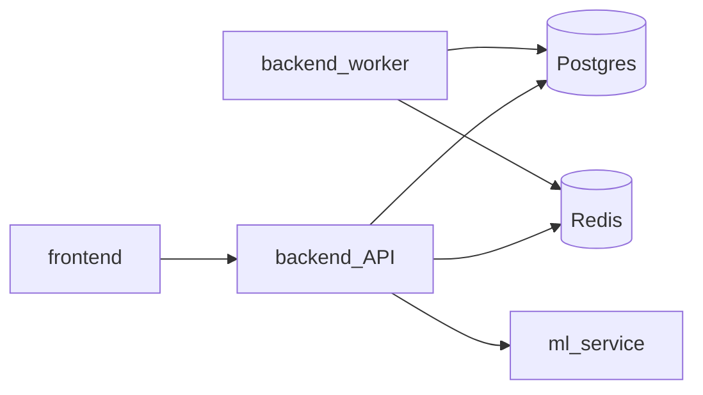

# Архитектура backend

## Слои `app/`

```
HTTP → routers → schemas (валидация)
              → models / db (Postgres, async SQLAlchemy)
              → services (ml_proxy, redis_stream)
              → workers (отдельный процесс)
```

| Каталог | Назначение |
|---------|------------|
| `routers/` | FastAPI-роуты, бизнес-логика endpoint'ов |
| `routers/super_admin/` | Endpoint'ы только для `super_admin` (клиники, …) |
| `schemas/` | Pydantic request/response |
| `models/` | SQLAlchemy ORM → таблицы Postgres |
| `db.py` | async engine, session (`get_db`) |
| `deps.py` | зависимости: текущий пользователь (JWT), `require_roles` / `require_privileged` / `require_clinic_admin` |
| `config.py` | настройки из env |
| `security.py` | JWT / password hash |
| `email.py` | SMTP (регистрация, clinic invite) |
| `services/` | ML proxy, Redis, clinic_members, questionnaire_* |
| `workers/` | фоновые consumer'ы |

Точка входа API: [`app/main.py`](../app/main.py) — сборка `FastAPI` и `include_router`.

## Два процесса одного image

Оба сервиса собираются из одного `Dockerfile`:

| Compose service | Команда | Роль |
|-----------------|---------|------|
| `backend` | `uvicorn app.main:app --host 0.0.0.0 --port 8000` | HTTP API |
| `backend-worker` | `python -m app.workers.ml_mkb_events_worker` | пишет stats/logs из Redis Stream |
| `questionnaire-worker` | `python -m app.workers.questionnaire_maintenance` | abandon 24h + purge 45d анкет |

Оба проходят общий [`entrypoint.sh`](../entrypoint.sh):

1. ожидание Postgres;
2. `alembic upgrade head`;
3. `python sql/seed/seed_refs.py`;
4. `exec` переданной команды.

## Внешние зависимости



- **Postgres** — основная БД (`POSTGRES_*`).
- **Redis** — stream событий ML/autocomplete (`REDIS_*`).
- **ml-service** — HTTP upstream (`ML_SERVICE_URL`, в docker-сети обычно `http://ml-service:8000`).

## Конфигурация в compose

- `env_file: .env` из корня `vismuth/`.
- Внутри сети контейнеров: `POSTGRES_HOST=db`, `REDIS_HOST=redis`, не IP хоста.
- Порт API на хост: `BACKEND_PORT` (по умолчанию 8000).
