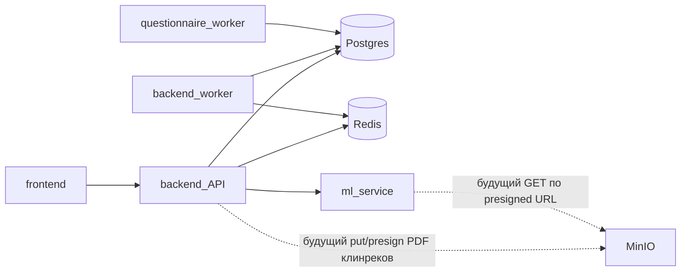

# Архитектура backend

Календарные `/appointment-dates` используют тот же scope доступа, что списки анкет: собственное врачебное членство, регистратура одной клиники или super_admin. Возвращаются только уникальные даты завершённых анкет. Генерация пациентских ссылок защищена `require_clinic_registry`; врач без административного членства получает 403.

## Слои `app/`

```
HTTP → routers → schemas (валидация)
              → models / db (Postgres, async SQLAlchemy)
              → services (ml_proxy, redis_stream)
              → workers (отдельный процесс)
```

| Каталог | Назначение |
|---------|------------|
| `routers/` | FastAPI-роуты, бизнес-логика endpoint'ов |
| `routers/super_admin/` | Endpoint'ы только для `super_admin` (клиники, статистика анкет, …) |
| `schemas/` | Pydantic request/response |
| `models/` | SQLAlchemy ORM → таблицы Postgres |
| `db.py` | async engine, session (`get_db`) |
| `deps.py` | зависимости: текущий пользователь (JWT), `require_roles` / `require_privileged` / `require_clinic_admin` |
| `config.py` | настройки из env |
| `security.py` | access JWT / password hash |
| `email.py` | SMTP (регистрация, clinic invite) |
| `services/` | ML proxy, Redis, clinic_members, questionnaire_*, refresh_tokens |
| `workers/` | фоновые consumer'ы |

Точка входа API: [`app/main.py`](../app/main.py) — сборка `FastAPI` и `include_router`.

## Процессы одного image

Три сервиса собираются из одного `Dockerfile`:

| Compose service | Команда | Роль |
|-----------------|---------|------|
| `backend` | `uvicorn app.main:app --host 0.0.0.0 --port 8000` | HTTP API |
| `backend-worker` | `python -m app.workers.ml_mkb_events_worker` | пишет stats/logs из Redis Stream |
| `questionnaire-worker` | `python -m app.workers.questionnaire_maintenance` | abandon 24h + purge 45d анкет |

Все проходят общий [`entrypoint.sh`](../entrypoint.sh):

1. ожидание Postgres;
2. `alembic upgrade head`;
3. `python sql/seed/seed_refs.py`;
4. `exec` переданной команды.

## Внешние зависимости



- **Postgres** — основная БД (`POSTGRES_*`).
- **Redis** — stream событий ML/autocomplete + rate-limit анкет (`REDIS_*`).
- **ml-service** — HTTP upstream (`ML_SERVICE_URL`, в docker-сети обычно `http://ml-service:8000`); анкета: `/collect_form` (уточнения, state в `questionnaire.collect_form_state`) и `/summarize_form` (после кода).
- **MinIO / Silo** — локальный S3 для PDF клинреков (`S3_*`, бакет `vismuth-clinrec`). В compose: сервисы `minio` + `minio-init` на образе `pgsty/silo`. Клиент: [`app/services/s3.py`](../app/services/s3.py) (presign + head). Каталог: `/clinrec/guidelines`, проверка: `POST /ml_clinrec_check`. Ключи: `guidelines/{source_id}/{version}/source.pdf`.

## Конфигурация в compose

- `env_file: .env` из корня `vismuth/`.
- Внутри сети контейнеров: `POSTGRES_HOST=db`, `REDIS_HOST=redis`, `S3_ENDPOINT_URL=http://minio:9000`, не IP хоста.
- Порты на хост задаются в `.env` и подставляются в compose: `FRONTEND_PORT` (3000), `BACKEND_PORT` (8000), `ML_SERVICE_PORT` (8001), `POSTGRES_PUBLISH_PORT` (5432), `REDIS_PUBLISH_PORT` (6379); MinIO — `MINIO_API_PORT` (9000) и `MINIO_CONSOLE_PORT` (9001). Порты внутри сети фиксированы, поэтому смена публикуемого порта не требует правок команд.

## Подключение сотрудников (0018_clinic_join)

`clinic_join_link` хранит hash токена, автора, время выдачи/отзыва; частичный unique index оставляет одну действующую ссылку на клинику. `clinic_join_request` хранит историю pending/approved/rejected; отдельный частичный unique index запрещает две pending-заявки одного аккаунта в одну клинику. Пароль находится только в auth, контекст email-подтверждения — JSONB `registration_pending.clinic_join_context` с существующим TTL.

`service_user.clinic_join_restricted` и `clinic_membership.is_operator` по умолчанию false, старые аккаунты не меняют права. `get_identity_user` проверяет JWT/активность и разрешает собственный статус/профиль. `get_current_user` дополнительно запрещает рабочие API ограниченным аккаунтам. `require_clinic_registry` разрешает super_admin либо активного clinic_admin/operator своей неудалённой клиники. `require_clinical_user` закрывает врачебные инструменты operator-only membership, сохраняя старые роли без membership.

Одобрение выполняется в одной транзакции: блокировка clinic → service_user → clinic_join_request, проверка подписки/членства/лимита, создание membership и специализаций, снятие ограничения. Создание/перевыпуск email-приглашений использует ту же блокировку clinic для лимита врача. Регистрация/подтверждение общей ссылки используют порядок clinic → link → registration_pending; отозванная ссылка не завершает регистрацию. Raw token отсутствует в БД.

Rate-limit публичного onboarding использует атомарный Redis INCR+EXPIRE Lua, ключ содержит хэш IP/email/аккаунта; при отказе Redis запрос не выполняется. Миграцию нельзя откатить, если остались заявки, активные ссылки, операторы, ограниченные аккаунты или контексты регистрации: сначала требуется явно сохранить/очистить данные. Автоматического снятия ограничений или потери решений при downgrade нет.

### Перевод пользователя супер-администратором

`services/user_membership.py` обслуживает `/super-admin/users*`. Порядок блокировок — целевая clinic → service_user → memberships, совместимый с одобрением заявки. Исходная клиника не блокируется: выход освобождает её слот. Подписка/роль/специализации/вместимость проверяются до деактивации; ошибка не снимает прежние права. В одной транзакции старые активные memberships деактивируются, целевое создаётся/активируется. ID и клиника исторических memberships/анкет не переписываются. Снятие клиники устанавливает `clinic_join_restricted`, назначение снимает его. Текущие права перечитываются из БД на каждом защищённом запросе, поэтому прежний JWT не сохраняет доступ к покинутой клинике. Для назначения допустим только платформенный `doctor`; глобальные роли endpoint не меняет. Новых таблиц и миграций не требуется.


## Единая роль сотрудника (0019_staff_roles)

Один справочник services/staff_roles.py и одно поле в UI. Старые платформенные role/DTO сохранены для совместимости; операции назначения, изменения членства и одобрения нормализуют сотрудника в служебный doctor и выставляют одну комбинацию флагов. Админ без врача и регистратор не получают clinical API; супер-админ защищён проверкой свежей роли под блокировкой. Общая ссылка разрешает запросить любую из четырёх ролей только с последующим решением супер-админа.

0019 расширяет ck_join_role без изменения старых строк; downgrade блокируется при заявках новых ролей. Операторское персональное приглашение явно запрашивается is_operator=true и хранится комбинацией двух false-флагов старой таблицы; свойство is_operator вычисляется, принятие создаёт operator-only членство. Откат приложения к старому образу запрещён при новых ролях заявок, незавершённых операторских приглашениях и admin-only членстве: нужен совместимый исправляющий выпуск, а не восстановление рабочей БД.
